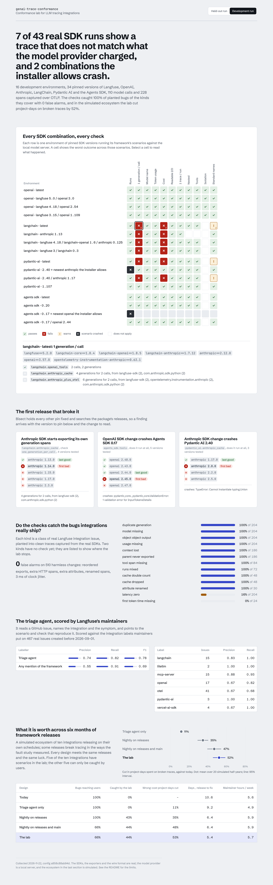

# genai-trace-conformance

A conformance lab for LLM tracing integrations. It runs the real OpenAI, Anthropic, LangChain, Pydantic AI and OpenAI
Agents SDKs, with Langfuse's integrations, against a local model server that knows exactly what every call cost. It
captures every span over OTLP at Langfuse's endpoint, and checks what a developer would see in their traces against
what really happened: one generation per model call, the right model, token usage with cached tokens counted once, the
right cost, readable input and output, one trace per run, tools traced, concurrent runs kept apart.

It does this across a matrix of pinned SDK versions, bisects any failure to the first release that caused it, and
includes a triage agent that reads GitHub issues and points to the scenario and check that reproduce them.

Why: integrations run inside other people's production systems, and the frameworks under them ship every week. In
Langfuse's issue tracker, the integration bugs of 2026 are mostly of a few kinds: generations duplicated by a second
instrumentation, cached tokens dropped or counted twice, output rendered as `[object Object]`, context lost across
async code. Each of these was found by a user. This lab is built to find them first.



## What it found

These come from real packages on PyPI, run unmodified:

- **Anthropic SDK 1.14.0 and later doubles every Claude generation behind LangChain and Pydantic AI.** The SDK now emits
  its own `gen_ai` spans and the Langfuse client's default filter exports them, so traced cost is +100% (+200% with the
  OpenLLMetry Anthropic instrumentor on as well). Bisect: last good 1.13.0, first bad 1.14.0. This matches the open
  Langfuse issue "anthropic SDK >=1.14 OTel spans exported by default, duplicating LangChain Claude generations". A draft
  report is in [docs/upstream](docs/upstream/anthropic-sdk-duplicate-generations.md).
- **The same SDK names cache writes `gen_ai.usage.cache_write.input_tokens`.** The GenAI conventions call it
  `cache_creation`. A backend that reads only the standard name prices those tokens as plain input.
- **Pydantic AI reports the same cache tokens under three names** (`gen_ai.usage.cache_read.input_tokens`,
  `gen_ai.usage.details.cache_read_input_tokens`, `gen_ai.usage.details.cache_read_tokens`). Summing them is the
  double count users reported in "gen_ai.usage.details.* metrics from PydanticAI cause Total Usage double-counting".
- **Installers allow combinations that crash.** Agents SDK 0.17 with OpenAI ≥ 2.45.0 fails on a new required usage
  field, and Pydantic AI 2.40 with Anthropic ≥ 2.0.0 fails on a type that became a union. Each was bisected to the
  release.
- **The integrations that use Langfuse's own wrappers are clean:** the OpenAI wrapper (plain, streaming, tools, cached
  prompts, asyncio and threads) on Langfuse 3.15 to 5.2, LangChain's CallbackHandler with OpenAI, and the Agents SDK
  through OpenInference.

## Results

<!-- results:start -->

_Generated by `python -m gtc.eval.cli readme` from `reports/`. Do not edit by hand._

### Development run · collected 2026-11-22 · config `a858c88ab94d` · gates pass

On 16 development environments (34 pinned SDK versions), 41 of 43 scenario runs completed and 2 crashed; the checks failed on 7 runs (cost_exact, one_generation_per_call). In the simulated ecosystem the lab cut project-days on broken traces by 52% (46% to 58%) against today.

| Environment | Runs | Crashed | Failing checks |
|---|---|---|---|
| openai · latest | 5 | 0 | none |
| openai · langfuse 5.0 / openai 3.0 | 5 | 0 | none |
| openai · langfuse 4.18 / openai 2.54 | 5 | 0 | none |
| openai · langfuse 3.15 / openai 1.109 | 5 | 0 | none |
| langchain · latest | 3 | 0 | langchain.anthropic_cache: one_generation_per_call (4 generations for 2 calls, from langfuse-sdk (2), com.anthropic.sdk.python (2))<br>langchain.anthropic_cache: cost_exact (traced $0.013865 vs charged $0.006933 (+100%))<br>langchain.anthropic_plus_otel: one_generation_per_call (6 generations for 2 calls, from langfuse-sdk (2), opentelemetry.instrumentation.anthropic )<br>langchain.anthropic_plus_otel: cost_exact (traced $0.020798 vs charged $0.006933 (+200%)) |
| langchain · anthropic 1.13 | 2 | 0 | langchain.anthropic_plus_otel: one_generation_per_call (4 generations for 2 calls, from langfuse-sdk (2), opentelemetry.instrumentation.anthropic )<br>langchain.anthropic_plus_otel: cost_exact (traced $0.013865 vs charged $0.006933 (+100%)) |
| langchain · langfuse 4.18 / langchain-openai 1.6 / anthropic 0.125 | 3 | 0 | langchain.anthropic_plus_otel: one_generation_per_call (4 generations for 2 calls, from langfuse-sdk (2), opentelemetry.instrumentation.anthropic )<br>langchain.anthropic_plus_otel: cost_exact (traced $0.013865 vs charged $0.006933 (+100%)) |
| langchain · langfuse 3 / langchain 0.3 | 3 | 0 | langchain.anthropic_plus_otel: one_generation_per_call (4 generations for 2 calls, from langfuse-sdk (2), opentelemetry.instrumentation.anthropic )<br>langchain.anthropic_plus_otel: cost_exact (traced $0.013865 vs charged $0.006933 (+100%)) |
| pydantic-ai · latest | 2 | 0 | pydantic_ai.anthropic_cache: one_generation_per_call (4 generations for 2 calls, from pydantic-ai (2), com.anthropic.sdk.python (2))<br>pydantic_ai.anthropic_cache: cost_exact (traced $0.013973 vs charged $0.006987 (+100%)) |
| pydantic-ai · 2.40 + newest anthropic the installer allows | 2 | 1 | pydantic_ai.anthropic_cache: runs (TypeError: Cannot instantiate typing.Union) |
| pydantic-ai · 2.40 / anthropic 1.17 | 2 | 0 | pydantic_ai.anthropic_cache: one_generation_per_call (4 generations for 2 calls, from pydantic-ai (2), com.anthropic.sdk.python (2))<br>pydantic_ai.anthropic_cache: cost_exact (traced $0.013973 vs charged $0.006987 (+100%)) |
| pydantic-ai · 1.107 | 2 | 0 | none |
| agents sdk · latest | 1 | 0 | none |
| agents sdk · 0.20 | 1 | 0 | none |
| agents sdk · 0.17 + newest openai the installer allows | 1 | 1 | agents_sdk.tools: runs (pydantic_core._pydantic_core.ValidationError: 1 validation error for InputTokensDetails) |
| agents sdk · 0.17 / openai 2.44 | 1 | 0 | none |

| First bad release | Package | Last good | First bad | Versions tested |
|---|---|---|---|---|
| Anthropic SDK starts exporting its own generation spans | anthropic | 1.13.0 | 1.14.0 | 4 |
| OpenAI SDK change crashes Agents SDK 0.17 | openai | 2.44.0 | 2.45.0 | 5 |
| Anthropic SDK change crashes Pydantic AI 2.40 | anthropic | 1.17.0 | 2.0.0 | 3 |

| Bug kind planted in real traces | Planted | Caught | Recall |
|---|---|---|---|
| attribute renamed | 30 | 30 | 100% |
| cache double count | 48 | 48 | 100% |
| cache dropped | 48 | 48 | 100% |
| context lost | 186 | 186 | 100% |
| duplicate generation | 204 | 204 | 100% |
| first token time missing | 24 | 0 | 0% |
| latency zero | 204 | 33 | 16% |
| model missing | 204 | 204 | 100% |
| object object output | 204 | 204 | 100% |
| parent never exported | 186 | 186 | 100% |
| runs mixed | 72 | 72 | 100% |
| tool span missing | 84 | 84 | 100% |
| usage missing | 204 | 204 | 100% |

Harmless changes (reordered exports, extra HTTP spans, extra attributes, renamed spans, 3 ms clock skew): 510, false alarms: 0.

| Triage against maintainers' integration labels | Issues | Precision | Recall | F1 |
|---|---|---|---|---|
| Triage agent | 467 | 0.74 | 0.82 | 0.78 |
| Any mention of the framework | 467 | 0.55 | 0.91 | 0.69 |

| Design | Bugs reaching users | Caught by the lab | Project-days on broken traces cut | Wrong-cost project-days cut | Median days, release to fix | Maintainer hours / week |
|---|---|---|---|---|---|---|
| Today: users report it, a maintainer reproduces and bisects by hand | 100% | 0% | – | – | 10.6 | 5.6 |
| Triage agent on incoming issues, no conformance runs | 100% | 0% | 11% (11% to 12%) | 11% (10% to 13%) | 9.2 | 4.9 |
| Nightly conformance runs on each new release, with bisect | 100% | 43% | 35% (29% to 40%) | 35% (27% to 41%) | 6.4 | 5.9 |
| Nightly runs on releases and on each framework's main branch | 66% | 44% | 47% (40% to 54%) | 48% (38% to 57%) | 6.4 | 5.9 |
| The lab: nightly on releases and main, bisect, triage agent | 66% | 44% | 52% (46% to 58%) | 53% (44% to 61%) | 5.4 | 5.7 |

_The held-out run has not happened yet._

<!-- results:end -->

## How it works

```
scenario (real SDKs, pinned venv) ──HTTP──▶ local model server ──▶ ledger: true usage per call
           │                                     (OpenAI + Anthropic APIs)
           └──OTLP/HTTP, basic auth──▶ receiver at /api/public/otel/v1/traces ──▶ spans as sent
                                                                                    │
                    checks: mapped observations vs ledger ◀── mapping (gen_ai, OpenInference, Langfuse usage_details)
```

- **Scenarios** (`scenarios/`) are written the way the frameworks' docs and Langfuse's guides show them: the drop-in
  OpenAI wrapper with `@observe`, LangChain's `CallbackHandler`, `Agent.instrument_all()` in Pydantic AI, the
  OpenInference instrumentor for the Agents SDK. Two scenarios run six concurrent runs under asyncio and threads.
- **The local model server** answers the OpenAI Chat Completions and Anthropic Messages APIs, streamed or not, with
  tool calls and prompt caching. It reports usage the way each provider does and records the truth in exclusive
  buckets: uncached input, cache read, cache write, output.
- **The mapping** reads each attribute family with its documented meaning. In the GenAI conventions, OpenAI's raw usage
  and OpenInference, input already includes cached tokens; Langfuse's `usage_details` keys are exclusive. Usage
  attributes it does not know are reported, not guessed.
- **Ten checks** compare each generation with the call it belongs to. Calls and generations are matched by time window,
  one to one first, so that close calls cannot swap.
- **The matrix** builds one uv virtualenv per pin set, from Langfuse 3.15 to 5.2, OpenAI 1.109 to 3.57, Anthropic
  0.125 to 2.12, LangChain 0.3 to 1.8, Pydantic AI 1.107 to 2.71 and the Agents SDK 0.17 to 0.25.
- **Bisect** finds the first release of one package that breaks a scenario, holding the other pins fixed.
- **The fault study** plants real bug kinds into clean captured traces, plus harmless changes that must not alarm.
- **The triage agent** labels issues and routes them to a scenario and check. It is scored against the integration labels
  Langfuse's maintainers put on 850 issues from April to November 2026, split by date.
- **The release simulation** plays six months of framework releases, some of which break tracing in the ways above. It
  compares five ways of catching them on the same luck: today's user reports, the triage agent alone, nightly runs on
  releases, nightly runs on releases and main branches, and all of it together.
- **The nightly job** (`.github/workflows/nightly.yml`) installs the newest release of every package and runs the
  scenarios. It fails only on a failure that is not already a known finding.

## Run it

```bash
uv venv -p 3.13 .venv && . .venv/bin/activate && uv pip install -r requirements.txt
pytest -q                                              # unit and end-to-end tests with the real SDKs
python -m gtc.cli repro langchain.anthropic_cache      # one scenario, every check
python -m gtc.cli repro langchain.anthropic_cache --pins anthropic==1.13.0
python -m gtc.cli bisect Anthropic SDK starts exporting its own generation spans
python -m gtc.cli triage 13075                         # a real Langfuse issue, triaged
python -m gtc.eval.cli dev                             # the whole matrix, bisections and analysis
python -m gtc.nightly                                  # newest releases against known findings
cd web && npm ci && npm run dev                        # the dashboard
```

[docs/cookbook.md](docs/cookbook.md) goes from zero to a checked trace, and shows how to add a framework.

## Limits

- **The model provider is a local server.** The SDKs, exporters and wire format are real, but rate limits, partial
  streams, provider errors and the Responses API are not imitated. The Agents SDK runs through its Chat Completions
  model.
- **The mapping is a reference, not Langfuse's server.** It follows the GenAI conventions, OpenInference and Langfuse's
  documented usage keys. Langfuse's ingestion may resolve some ambiguities differently. The duplicate-generation finding
  does not depend on the mapping: the extra spans are on the wire.
- **Recall is 100% on the eleven bug kinds the checks were written for**, because the faults are planted in the form the
  checks look for. Two real kinds without a check show the boundary: missing completion start time is never caught, and
  zero latency is caught only by accident.
- **Five integrations have scenarios.** The Vercel AI SDK, LiteLLM, LlamaIndex, CrewAI and voice frameworks such as
  LiveKit and Pipecat do not yet. In the simulation they can only be caught by users.
- **The release simulation is a model.** Release rates, user shares, break probability, report rates and how often a
  change is on main before release are assumptions in `config/world.json`, sized from public release histories, not
  Langfuse data. The relative ordering of designs is the useful output, not the absolute project-days.
- **Maintainers' labels are incomplete.** Some issues plainly about the LangChain handler carry no integration label, so
  the triage agent's precision against them is a lower bound. The agent's rules were written on issues before
  2026-09-01; the issues after that date are held out.
- **Pins without a lock file.** Each environment pins the packages named in it; transitive dependencies resolve at build
  time, so a rebuild months later can differ. The stored captures in `reports/raw/` keep every result reproducible.

## Layout

```
scenarios/              integrations under test (import only the SDKs)
gtc/harness/            local model server, OTLP receiver, truth ledger
gtc/mapping.py          spans to observations: type, model, usage, cost, input, output
gtc/checks.py           the ten checks
gtc/matrix.py           pinned environments; gtc/bisect.py first bad release
gtc/faults.py           real bug kinds and harmless changes
gtc/triage.py           the issue triage agent
gtc/world.py            the release simulation (no imports from the lab)
gtc/eval/               collect, analyse, report, gates, held-out lock
gtc/nightly.py, gtc/cli.py
config/                 prices, dialects, scenarios, environments, bisections, world, designs, gates, seeds, triage
data/issues.jsonl       Langfuse GitHub issues, April to November 2026 (public)
web/                    dashboard (React, Vite, Framer Motion)
docs/                   ADRs, cookbook, draft upstream reports, screenshots
```
